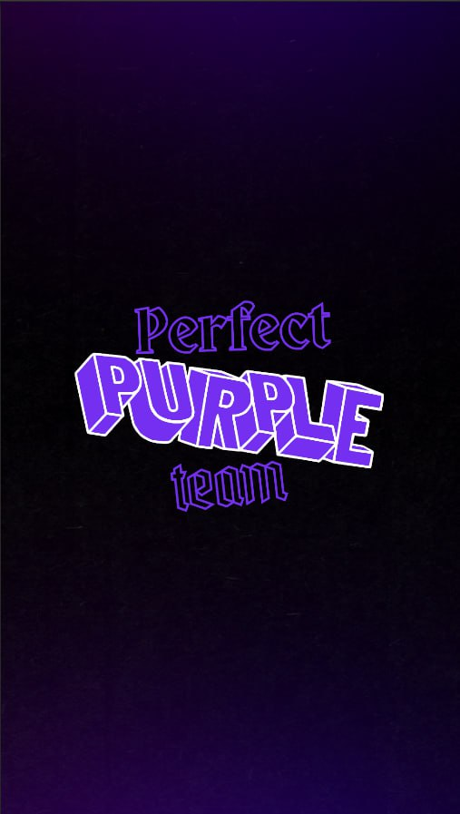
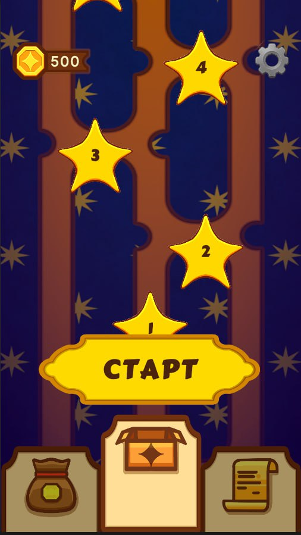
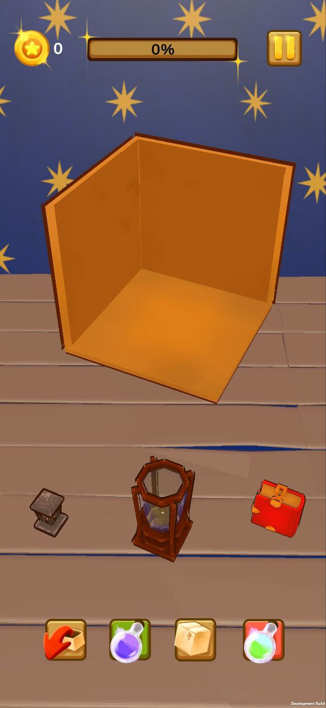
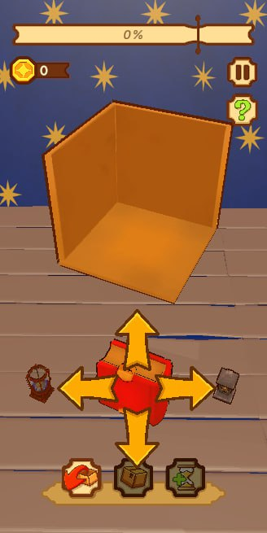
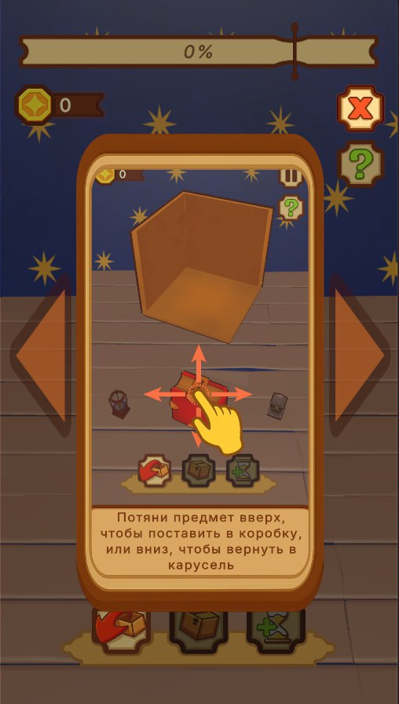
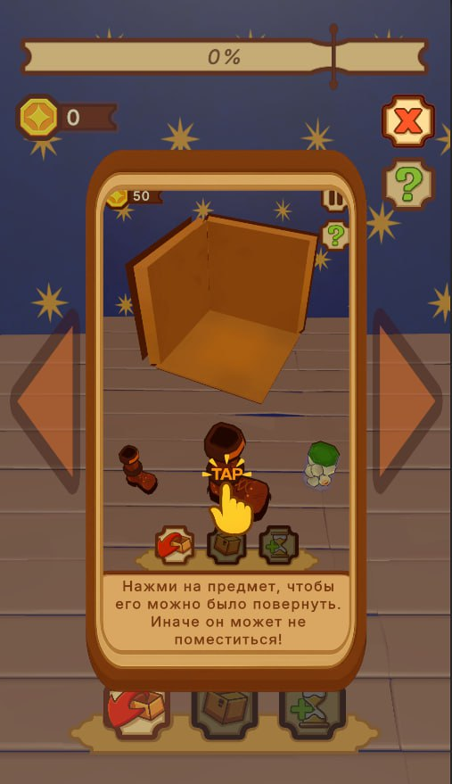

# Once Upon a Box

**Once Upon a Box** is a cozy 3D packing puzzle set in a colorful, magical shop. Each level gives you a box and a collection of unusual objects. Find a place for every item, turn awkward shapes to discover a better fit, and fill the box as efficiently as you can.

The game combines the familiar satisfaction of arranging objects with the spatial challenge of a 3D puzzle. Its bright fantasy presentation, friendly controls, and short levels are designed for relaxed play on a mobile device.

## Screenshots

The screenshots below show the team splash screen, level selection, gameplay, and the in-game tutorials. They are displayed in equal-size frames to keep the gallery compact.

<table>
  <tr>
    <td align="center"> Team splash screen</td>
    <td align="center"> Level selection</td>
    <td align="center"> Gameplay screen</td>
  </tr>
  <tr>
    <td align="center"> Moving an item</td>
    <td align="center"> Movement tutorial</td>
    <td align="center"> Rotation tutorial</td>
  </tr>
</table>

## How to play

1. Choose a level from the map.
2. Inspect the open box and the objects waiting to be packed.
3. Select an object, then move or rotate it to find a suitable position.
4. Keep arranging objects until you meet the level's packing goal.
5. Complete levels to earn coins and continue exploring the map.

The tutorials introduce the basic gestures as you play. The box, objects, and progress meter stay visible together so you can judge available space while planning your next move.

## Game features

- **Three-dimensional packing puzzles:** think about an object's shape and orientation as you place it in the box.
- **Move and rotate controls:** adjust objects to make room for the rest of the collection.
- **Level progression:** follow a level map, complete challenges, and collect coins.
- **Helpful tutorials:** learn the main interactions through short visual instructions.
- **Whimsical presentation:** explore a warm, cartoon-inspired world of magical goods, rich colors, and playful interface details.
- **Short mobile sessions:** each level is built around a focused packing challenge that can be played at your own pace.

## Platforms

Designed for portrait-oriented mobile devices, with iOS and Android as target platforms.

## Project documentation

The [visual design document](visualdoc.md) contains the game concept, target audience, gameplay ideas, visual direction, monetization concepts, references, and long-term plans.
