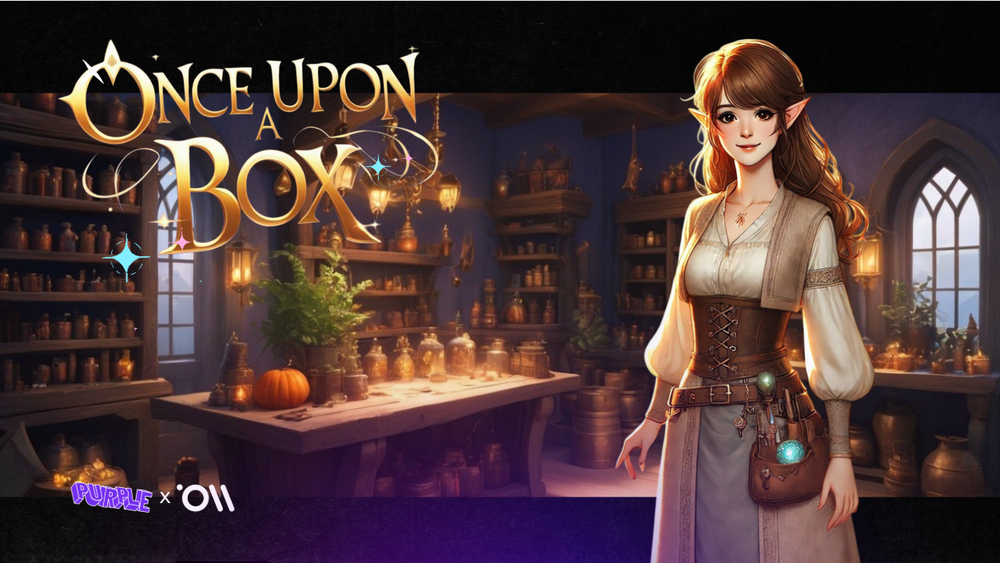
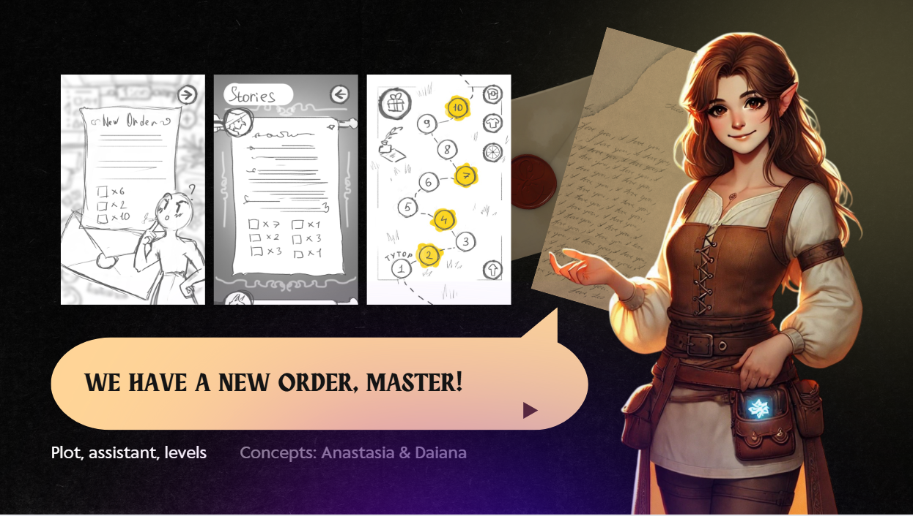
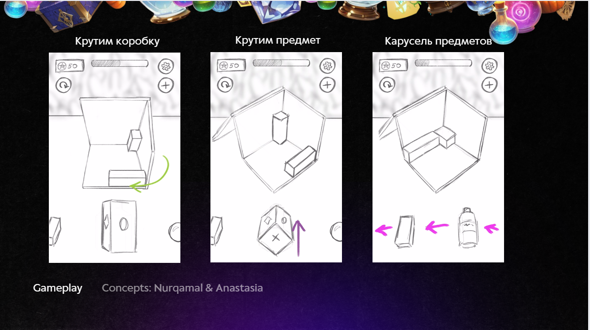
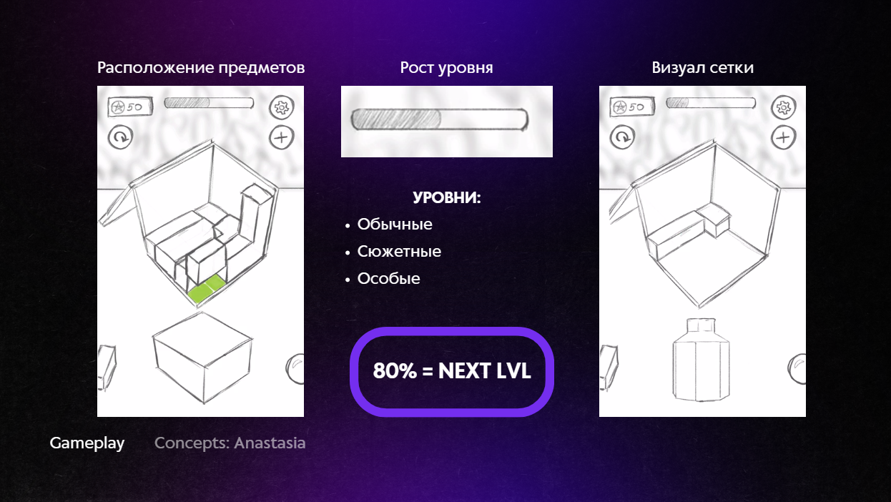
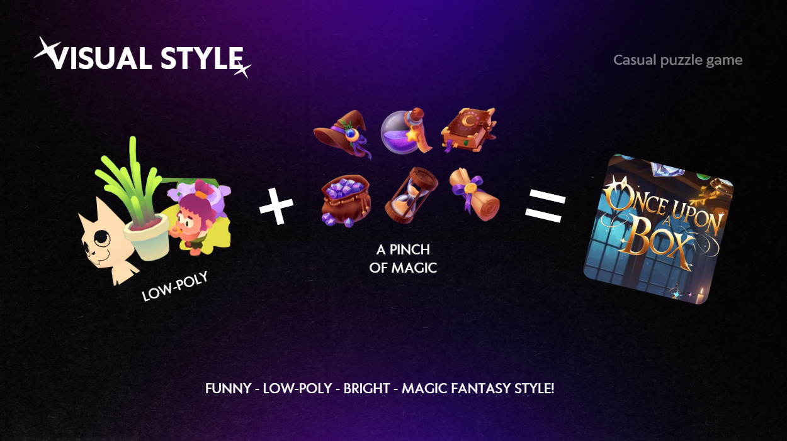
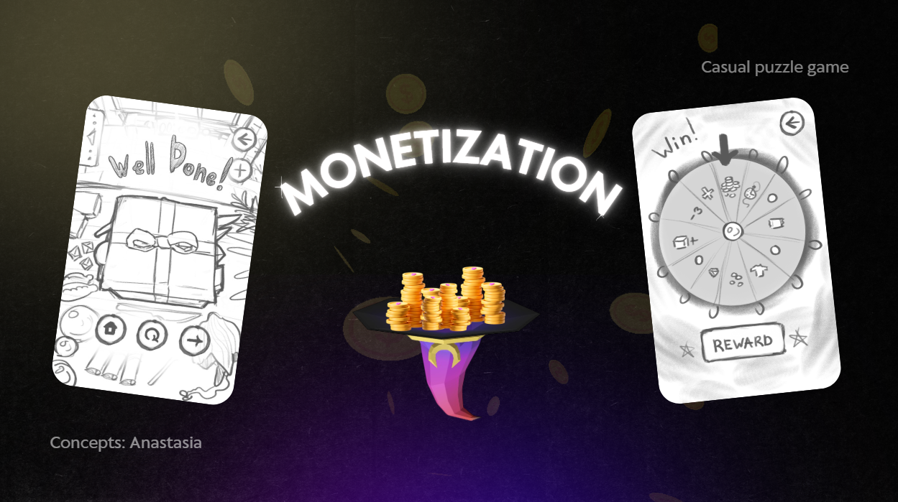
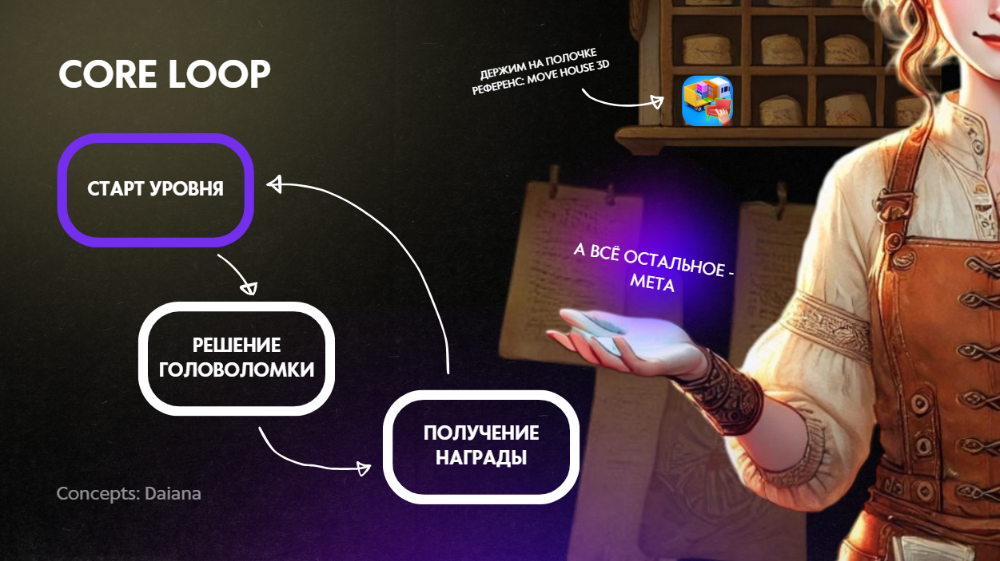
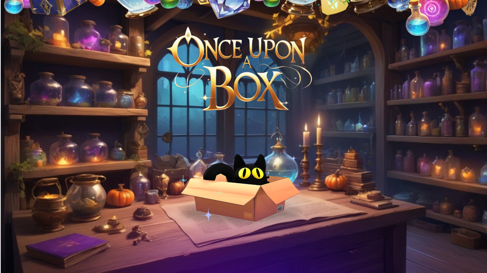

# Once Upon a Box

**Жанр:** Головоломка, 3D Тетрис

**Платформы:** Мобильные (Android)

**Формат:** Вертикальная ориентация экрана для удобного управления одной рукой

**Целевая аудитория:** Любители головоломок, тетриса, фэнтези и визуально приятного дизайна.

## 1. Общее описание

Игра представляет собой головоломку, в которой игрок выступает в роли упаковщика волшебных товаров в магическом магазине. Задача — грамотно размещать предметы в коробке, используя механику 3D-тетриса, учитывая форму, размер и свойства каждого объекта.

## 2. Уникальное торговое предложение (USP)

- **Магическая тематика** – редкое сочетание фэнтези и тетрис-механик.
- **Глубокая физическая механика** – уникальные ограничения, такие как хрупкие предметы, тяжелые грузы, сложные формы.
- **Тактильное и визуальное удовольствие** – реалистичная анимация перемещения предметов, красивый арт и плавные визуальные эффекты.
- **Легкое освоение, сложное мастерство** – простой входной порог, но глубокий уровень проработки и челленджей.

## 3. Игровой процесс

- Игрок получает коробку и список предметов, которые нужно уложить.
- Возможность вращать предметы в любом направлении, экспериментируя с комбинациями.
- Ограничения: определенные предметы нельзя ставить рядом, хрупкие вещи должны находиться сверху, а тяжелые — снизу.
- Уровень считается завершенным, если коробка заполнена на 80% или более.
- Усложнения: таймер, уменьшение размера коробки, частично заполненная коробка, ограниченная видимость.

## 4. Визуальный стиль

- **Стиль:** мультяшная, минималистичная, low-poly графика с приятными текстурами.
- **Цветовая палитра:** мягкие, уютные тона, напоминающие магические лавки и старинные книги.
- **Анимации:** плавные, приятные глазу, с эффектами легкой магии при удачном размещении предмета.

## 5. Монетизация

- **Просмотр рекламы:** за дополнительные подсказки или бонусные предметы.
- **Покупка бустеров:** возможность приобрести улучшения, например, авто-размещение нескольких предметов.
- **Кастомизация:** покупка скинов для коробок и предметов.
- **Отключение рекламы:** платная функция для комфортной игры без прерываний.

## 6. Кор-луп

Игрок заходит в игру – видит красивый главный экран. Выбирает уровень – загружается экран с волшебной атмосферой. Начинает размещать предметы в коробке. Завершает уровень и получает награду. Повторяет процесс на новом уровне.

## 7. Референсы

- **Игры:** Movehouse 3D, *Unpacking*, *Tetris 3D и* Slash quest, Forest island, Tiny Cafe, Webfishing (за визуальный стиль).
- **Фильмы и книги:** *Гарри Поттер* (магазин волшебных предметов), Шрек (сказочная сатира и постирония), Disenchantment  и *Ходячий замок* (магическая эстетика).

## 8. Тональность и настроение

- Дружелюбная и уютная атмосфера.
- Чувство удовлетворения от аккуратного размещения предметов.
- Спокойная, но увлекательная игра, идеально подходящая для коротких сессий.
    
    
    

## 9. Долгосрочное развитие

- **Добавление новых тем:** волшебные магазины разных культур, лаборатории алхимиков, пиратские сундуки.
- **Ивенты:** сезонные обновления с уникальными предметами и уровнями.
- **PvP-режим:** соревнования на время с другими игроками по укладке предметов.
